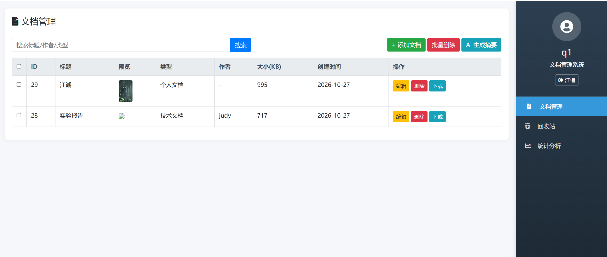
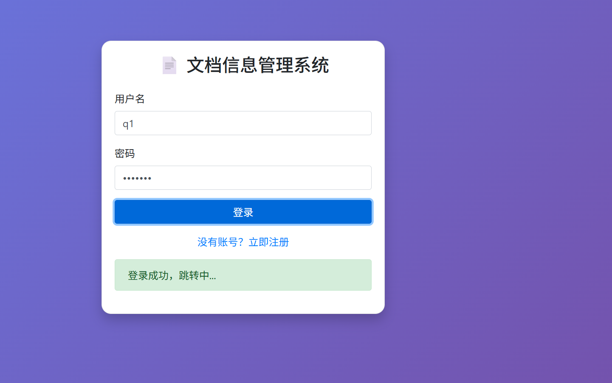
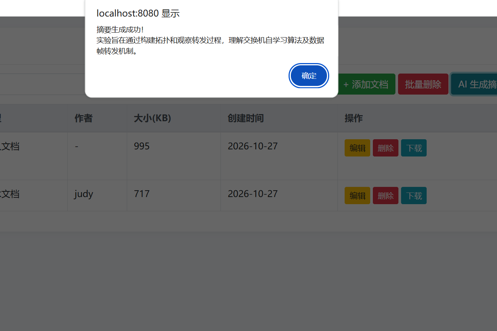

# 初始用户及密码
name:admin;secret:123456
name:judy;secret:666666

# AI 赋能的多租户文档管理系统

基于 Spring Boot + MyBatis + MySQL 的多用户文档管理平台，支持文件上传、回收站恢复和 AI 智能摘要。

## 技术栈

| 分类 | 技术 |
|------|------|
| 后端 | Spring Boot 3.2、MyBatis、MySQL 8.0、Redis |
| 前端 | HTML/CSS/JavaScript、Bootstrap 4.5、jQuery |
| 安全 | BCrypt 密码加密 |
| AI | DeepSeek API（文档摘要生成） |
| 部署 | 阿里云轻量应用服务器、Linux |

## 功能列表

- 用户注册、登录、注销（BCrypt 密码加密）
- 文档增删改查、模糊搜索、批量删除
- 软删除 + 回收站恢复 + 永久删除
- 文件上传、预览、下载
- 大文件分片上传：2MB 分片、3 片并发、失败重试、断点续传（不依赖文件 MD5）
- 多用户数据隔离（每个用户只能操作自己的文档）
- Redis 缓存文档列表，提升查询性能
- AI 智能摘要生成（调用 DeepSeek API）

## 界面展示

**登录页**：支持注册、登录，密码 BCrypt 加密存储，登录成功自动跳转到文档管理页。



**文档管理主页**：左侧为文档列表，支持标题/作者/类型模糊搜索、批量删除、图片预览、编辑与下载；右侧为功能导航（文档管理、回收站、统计分析）。



**AI 智能摘要**：选中任意文档一键生成摘要，内容由 DeepSeek 大模型根据文档正文自动提炼。



## 项目结构
src/main/java/com/javaee/documentsystem/
├── common/ # 统一返回格式、密码工具、全局异常处理
├── config/ # 静态资源映射配置
├── controller/ # UserController、DocumentController
├── entity/ # User、Document
├── mapper/ # UserMapper、DocumentMapper
└── service/ # UserService、DocumentService
src/main/resources/
├── mapper/ # MyBatis XML
├── static/ # login.html、register.html、main.html
└── application.properties


## 如何启动

### 1. 创建数据库

```sql
CREATE DATABASE document_system CHARACTER SET utf8mb4 COLLATE utf8mb4_unicode_ci;
```

### 2. 导入表结构与数据

导入项目根目录下的 `document_system.sql`。

### 3. 准备本地配置

真实的 `application.properties` 和 `.env` 都不入库（里面是数据库密码和 API Key），首次拉代码后从模板复制：

```bash
copy src\main\resources\application.properties.example src\main\resources\application.properties
copy .env.example .env
```

macOS / Linux 用 `cp`。然后在 `.env` 里填 `AI_DEEPSEEK_API_KEY`（`MYSQL_PASSWORD` 默认 123456，按本机改）。

没有 `.env` 也能启动：AI 摘要会提示"未配置"，登录、文档、回收站、分片上传都不受影响。

### 4. 启动 Redis（可选）

Redis 只用于缓存文档列表。**不启动 Redis 也能完整使用所有功能**：缓存连接失败时会自动降级为直查数据库，日志中出现 `[缓存降级] Redis 读取失败…本次走数据库` 警告属正常现象；启动 Redis（默认端口 6379）后自动恢复缓存。

### 5. 启动项目

运行 `DocumentSystemApplication.java`。

### 6. 访问

http://localhost:8080/login.html

## 接口示例

- POST /api/user/login          用户登录
- POST /api/user/register       用户注册
- GET  /api/document/list       查询文档列表
- POST /api/document/add        添加文档（含文件）
- GET  /api/document/search     模糊搜索
- DELETE /api/document/deleteBatch   批量删除
- GET  /api/document/recycle/list    回收站列表
- PUT  /api/document/recycle/restore/{id}   恢复文档
- POST /api/ai/summary          AI 生成摘要
- POST /api/document/upload/init     初始化分片上传（返回分片计划与已传序号）
- POST /api/document/upload/chunk    上传单个分片
- POST /api/document/upload/merge    校验并合并分片、写入文档记录
- POST /api/document/upload/abort    取消上传、清理临时分片

## 在线访问

部署地址：http://47.95.122.184:8080/login.html
测试账号：admin / 123456

## 注意

- `src/main/resources/application.properties`、`.env` 已被 `.gitignore` 排除，换机器时从同目录的 `*.example` 复制一份
- 仓库里只有模板，数据库密码、API Key 都不入库
- `target/`、`.idea/`、`*.iml`、`chunk-temp/` 同样不提交